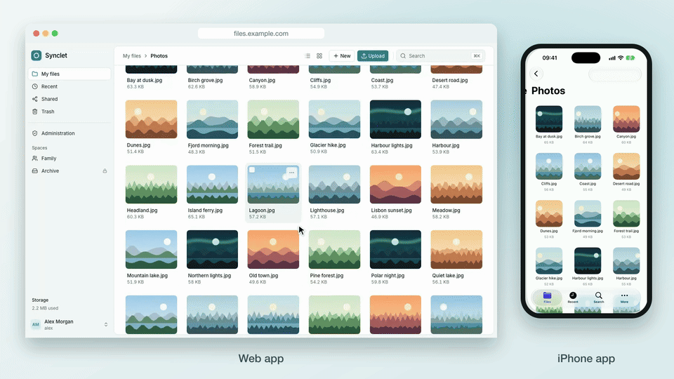

# Synclet

**A cloud drive for your own server that leaves your files exactly as they are.**

[](https://eltomato89.github.io/synclet/)
[-0f7c8a)](https://github.com/eltomato89/synclet/releases/latest/download/Synclet.dmg)
[](https://testflight.apple.com/join/NA3Aphqe)
[-0f7c8a)](https://github.com/eltomato89/synclet/releases/latest/download/Synclet.apk)
[](#get-started)
[](LICENSE)

<picture>
  <source media="(prefers-color-scheme: dark)" srcset="docs/assets/readme-hero-dark.gif">
  
</picture>

Synclet turns a folder on your server into a cloud drive you can use from the browser, your Mac, your iPhone and your Android phone. Underneath it's still just a folder: no blobs in a database, no metadata files in your folders. Stop using Synclet tomorrow and your files are exactly where you left them.

## Why Synclet?

- **Plain files, always.** Synclet works with the files already on your disk. Change something over SMB or in a shell and Synclet picks it up. Rename it in the app and it's renamed on disk.
- **Apps that feel at home.** Your files show up in Finder, in the iOS Files app and in Android's file picker, and download only when you open them.
- **Made for sharing at home.** Shared folders for the family and the NAS shares you already have, with read or write access per person or group.
- **One small stack.** Server, worker, PostgreSQL and Caddy in one Docker Compose file. Updates are a version bump.

## What you get

- **Web app:** upload, browse and search, including the text inside your documents. Previews for photos (HEIC too), videos, PDFs and text. Select many files at once to move, copy or download them as a ZIP.
- **Apps** for Mac, iPhone & iPad and Android.
- **Share links** with an optional password and expiry date.
- **Trash** for 30 days, and optional file versions.
- **Optional:** edit Office documents in the browser (Euro-Office) and sign in with your identity provider (OIDC or forward-auth).

Everything in detail: [Documentation](docs/README.md).

## Get started

You need a Linux machine or NAS with Docker. Synclet runs from prebuilt images for amd64 and arm64.

**1. Download two files**

```bash
mkdir synclet && cd synclet
curl -fsSLO https://raw.githubusercontent.com/eltomato89/synclet/main/deploy/compose.yml
curl -fsSL -o .env https://raw.githubusercontent.com/eltomato89/synclet/main/deploy/.env.example
```

**2. Create the folders and fill in `.env`**

Synclet needs a folder for your files and a separate one for its own data (thumbnails, trash, versions). The second must not be inside the first.

```bash
sudo mkdir -p /srv/files /srv/synclet-meta
sudo chown "$(id -u):$(id -g)" /srv/files /srv/synclet-meta
mkdir -p teams
sed -i.bak -e "s/^PUID=.*/PUID=$(id -u)/" -e "s/^PGID=.*/PGID=$(id -g)/" \
  -e "s/^POSTGRES_PASSWORD=.*/POSTGRES_PASSWORD=$(openssl rand -hex 24)/" .env && rm .env.bak
```

Then check `SYNCLET_DATA` and `SYNCLET_META` in `.env`, and set `SYNCLET_VERSION` to a release (for example `0.1.7`) instead of `latest`.

**3. Start it**

```bash
docker compose up -d
```

Open `http://localhost:8080` and create your account. Your username becomes your folder in `/srv/files`. If a folder with that name already exists, its files show up right away.

Next steps: [put it behind your reverse proxy](docs/configuration.md#behind-another-reverse-proxy), [add shared folders and NAS shares](deploy/README.md#team-folders-and-external-storage), [install the apps](docs/apps.md).

### Updating

Set the new `SYNCLET_VERSION` in `.env`, then run `docker compose pull && docker compose up -d`. Synclet updates its database on start, and you can't go back to an older version afterwards. Back up the database first and read the [release notes](https://github.com/eltomato89/synclet/releases). More in [Installing and updating](docs/installation.md).

## Documentation

- [Installing and updating](docs/installation.md): image tags, updates, building from source
- [Configuration](docs/configuration.md): every setting, PostgreSQL, running behind a reverse proxy
- [Files and storage](docs/storage.md): what Synclet writes where, disk usage, what it may put in your folders
- [Team folders and external storage](deploy/README.md#team-folders-and-external-storage)
- [Office](docs/office.md): editing documents in the browser with Euro-Office
- [Versions](docs/versions.md): keeping earlier versions of your files
- [Single sign-on](docs/single-sign-on.md): OIDC, forward-auth, emergency access
- [Apps](docs/apps.md): signing in from the apps, Mac, Android
- [Admin area](docs/admin.md)
- [Known limitations and security notes](docs/limitations-and-security.md)
- [Development](docs/development.md): building, tests, database migrations, architecture
- [Sync API](docs/sync/SYNC_API.md): for client developers

## Good to know

- **Deleting on the server's disk skips the trash.** Only deletes made through Synclet can be restored.
- **Network shares (SMB/NFS)** don't report changes reliably. Set the space to "scan only" and Synclet checks it on a schedule instead.
- **On a Mac host with Docker Desktop**, moves made in Finder look like delete + create, so the apps download the file again. Linux hosts don't have this problem.

More in [Known limitations and security notes](docs/limitations-and-security.md).

## Leaving Synclet

`docker compose down -v` removes the containers and Synclet's database. Your files stay where they are, untouched.

## How it's built

A NestJS server and worker, PostgreSQL for the index, and Caddy serving the React web app, packed into two images for amd64 and arm64. Apps in Swift (Mac, iPhone, iPad) and Kotlin (Android). Want to help? See [Development](docs/development.md).

## License

[MIT](LICENSE) © 2026 Jens Köhler. Built with the help of AI coding assistants (Anthropic's Claude), under human direction and review. Issues and contributions are welcome.
